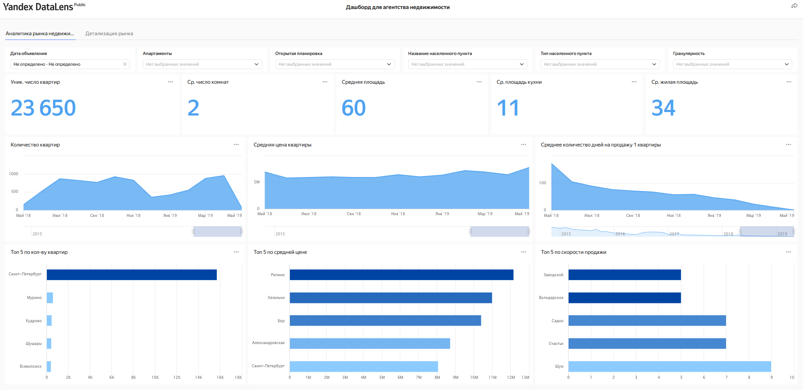

# Анализ рынка недвижимости Санкт-Петербурга и Ленинградской области

**Стек:** PostgreSQL, SQL, Yandex DataLens.

Исследование архивных объявлений сервиса Яндекс Недвижимость для агентства недвижимости. Задача — сравнить характеристики объектов, сроки размещения и сезонность, чтобы определить перспективные сегменты рынка и периоды маркетинговой активности.

*Архивный скриншот дашборда Yandex DataLens. Интерактивная версия сейчас недоступна из-за отсутствия подключения к учебной базе данных.*

## Что исследовано

- Продолжительность активности объявлений и характеристики квартир в Санкт-Петербурге и других населённых пунктах.
- Сезонность публикации и снятия объявлений, изменения площади и стоимости квадратного метра.
- Различия между населёнными пунктами по объёму объявлений, ценам и срокам размещения.

## Ключевые выводы

- Квартиры меньшей площади и с более низкой ценой квадратного метра характеризовались более короткими сроками размещения; крупные объекты оставались в публикации дольше.
- Больше всего объявлений публиковали в ноябре (**10,86%**) и феврале (**10,23%**), меньше всего — в январе (**5,4%**) и мае (**6,31%**).
- Наибольшие доли снятий приходились на октябрь (**10,18%**) и ноябрь (**9,85%**). Осеннюю активность рекомендовано учитывать при планировании маркетинга.
- По количеству объявлений выделялись **Мурино, Кудрово и Шушары** — в отчёте они предложены как перспективные направления работы агентства.
- Среди 15 лидирующих по количеству публикаций населённых пунктов в сравнении отчёта средняя цена квадратного метра составляла **58 669 руб. в Выборге** и **104 158 руб. в Пушкине**.

## Инструменты и методы

В PostgreSQL использованы JOIN, CTE, CASE, FILTER, агрегирование, оконные суммы и DENSE_RANK, медианы и перцентили для фильтрации выбросов. Объекты сегментированы по срокам размещения. В Yandex DataLens доработаны KPI, фильтры, временные графики и сравнения населённых пунктов.

## Материалы проекта

- [SQL-запросы](1st_module_project_Bushmina_2.sql).
- [Аналитический отчёт DOCX](%D0%90%D0%BD%D0%B0%D0%BB%D0%B8%D0%B7%20%D0%B4%D0%B0%D0%BD%D0%BD%D1%8B%D1%85%20%D0%B4%D0%BB%D1%8F%20%D0%B0%D0%B3%D0%B5%D0%BD%D1%82%D1%81%D1%82%D0%B2%D0%B0%20%D0%BD%D0%B5%D0%B4%D0%B2%D0%B8%D0%B6%D0%B8%D0%BC%D0%BE%D1%81%D1%82%D0%B8%20(SQL%20%D0%B8%20DataLens).docx).

## Ограничения

Проект выполнен в рамках обучения аналитике данных. Учебная база недоступна, поэтому повторная проверка расчётов не проводилась. Снятие объявления с публикации не подтверждает продажу; сроки размещения нельзя приравнивать к срокам сделки. Территориальные группы соответствуют исходному учебному кейсу и не являются строгим делением по административным границам.
