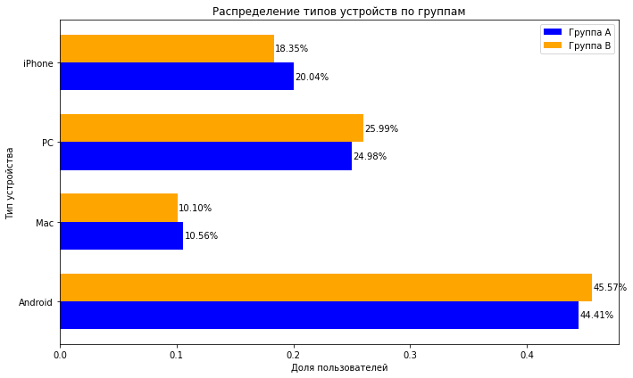

# A/B-тест нового алгоритма рекомендаций

**Стек:** Python, pandas, NumPy, SciPy, statsmodels, matplotlib.

## О проекте

Команда продукта тестирует новый алгоритм рекомендаций для развлекательного приложения с бесконечной лентой. Целевая метрика — доля успешных сессий: сессий с просмотром четырёх и более страниц.

## Задача

Спланировать A/B-тест, проверить распределение пользователей по группам и оценить изменение целевой метрики.

## Что сделано

- Проанализированы исторические данные и динамика пользовательской активности.
- Рассчитаны параметры эксперимента: размер выборки, мощность и длительность теста.
- Проверены численность групп, пересечения пользователей и распределение по устройствам и регионам.
- Проведён статистический анализ числа сессий и доли успешных сессий.

*Проверка состава групп по типам устройств. Сохранённый график из ноутбука.*

## Основные результаты

В исходном учебном исследовании получены следующие результаты:

- Доля успешных сессий в контрольной группе A — **30,77%**.
- Доля успешных сессий в тестовой группе B — **31,83%**.
- Разница между группами — **+1,06 процентного пункта** в пользу группы B.
- В сохранённом результате z-теста пропорций **p-value = 0,0002**.

В рамках исследования различие интерпретировано как статистически значимое; результаты поддерживают гипотезу о более высокой доле успешных сессий в группе B.

## Инструменты и методы

pandas и NumPy — подготовка и агрегация данных; matplotlib — визуализация; statsmodels — расчёт мощности и параметров эксперимента, z-тест пропорций; SciPy — t-тест для сравнения среднего числа дневных сессий.

## Материалы

[Ноутбук с анализом и сохранёнными результатами](ab_test_analysis.ipynb)
