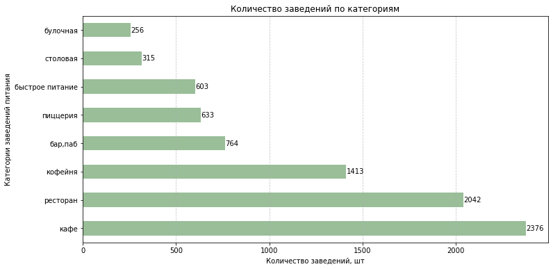
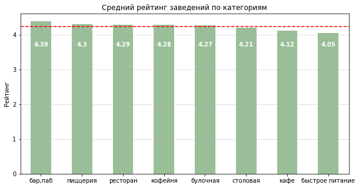
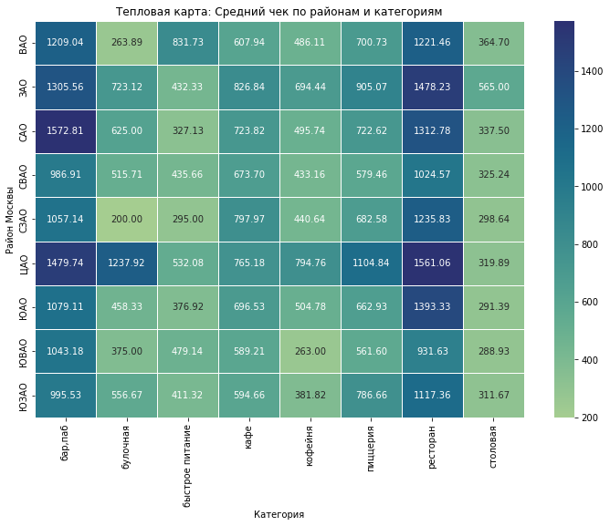

# Анализ рынка общественного питания Москвы

**Стек:** Python, pandas, NumPy, matplotlib, seaborn, phik.

## О проекте

Исследование московского рынка общепита для оценки его структуры, цен, конкуренции и особенностей разных форматов заведений. Анализ помогает сравнить сегменты рынка при выборе концепции и расположения нового заведения.

## Что исследовано

Категории заведений и их распределение по округам, сетевые и несетевые форматы, посадочные места, рейтинги, средние чеки и цены на кофе.

*Структура предложения: кафе, рестораны и кофейни представлены чаще остальных форматов.*

## Основные результаты

- В выборке представлены **8 категорий**: больше всего кафе — **2 376**, затем ресторанов — **2 042**; меньше всего булочных — **256**.
- В ЦАО сосредоточено **2 242 заведения**, в СЗАО — **409**. В ЦАО самая многочисленная категория — рестораны (**670**).
- Средние рейтинги категорий находятся в диапазоне **4,05–4,39**: у баров и пабов — **4,39**, у быстрого питания — **4,05**.
- По числу заведений среди выделенных сетей лидирует «Шоколадница» — **119 точек**; у замыкающей топ-15 «Кофемании» — **22**.
- На тепловой карте средний чек ресторанов в ЦАО составляет около **1 561 ₽**, в ЮВАО — **931 ₽**. Это сравнение заведений с доступными данными о чеке.

*Средние рейтинги категорий; пунктиром отмечен общий средний уровень.*

*Средний чек по округам и категориям. Значения-заглушки пропусков исключены.*

## Инструменты и методы

Обработка пропусков и дубликатов, объединение таблиц, группировки, визуализация распределений и сравнение категорий. Корреляционный анализ phik использован для изучения связей рейтинга с характеристиками заведений.

## Материалы

[Jupyter Notebook с исследованием и сохранёнными результатами](restaurant_market_analysis.ipynb)

## Ограничения

В данных есть пропуски в ценах и количестве мест, а также выбросы. Рейтинги основаны на пользовательских оценках. Выводы описывают представленную выборку и не гарантируют коммерческий успех конкретной локации.
