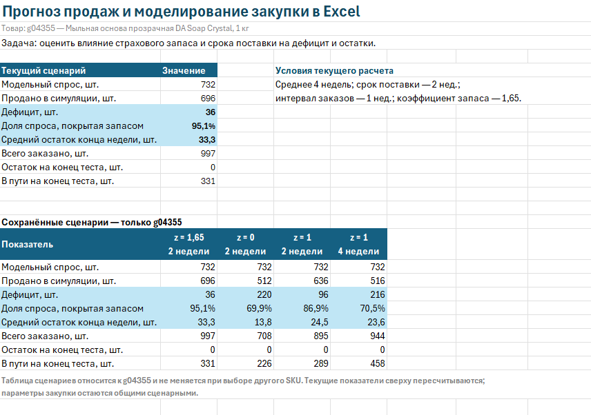
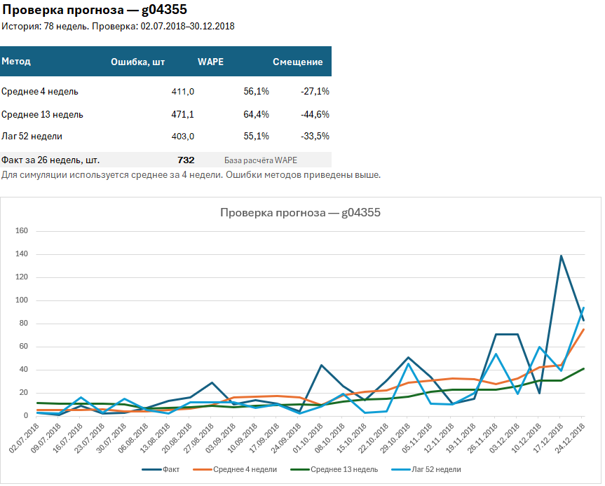
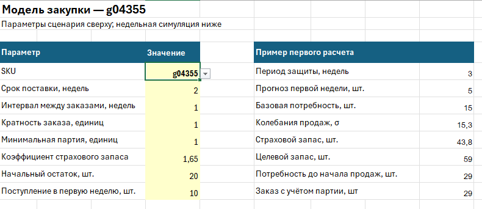

# Прогноз продаж и моделирование закупок в Excel

Сценарная модель прогнозирования продаж и закупки на реальных данных собственного интернет-магазина. Проект показывает, как страховой запас и срок поставки влияют на дефицит и остатки.

[Скачать Excel-модель](./Прогноз%20продаж%20и%20моделирование%20закупок.xlsx)

## Скриншоты

### Обзор и сравнение сценариев

### Проверка прогнозов

### Параметры закупки

## Задача

Сравнить три простых метода прогнозирования и смоделировать пополнение запасов с учётом срока поставки, интервала заказов, минимальной партии и кратности.

## Данные

История товарных позиций оплаченных заказов. Для анализа использованы 104 полные недели за период 02.01.2017–30.12.2018:

- первые 78 недель — начальная история;
- последние 26 недель — проверка прогнозов и симуляция закупки.

В модель включены шесть артикулов мыльной основы, отобранных по продажам первых 78 недель. В публичной книге оставлены дата, артикул, название товара, количество и расчётные поля.

## Что сделано

- Подготовлены данные и сводная таблица продаж по неделям.
- Сравнены прогнозы: среднее предыдущих 4 недель, среднее 13 недель и продажи 52 недели назад.
- Точность оценена по WAPE — отношению суммы абсолютных ошибок к фактическим продажам. Рассчитано также смещение прогноза.
- Построена недельная симуляция поступлений, продаж, дефицита и остатков.
- Добавлен расчёт заказов с учётом товара в пути, страхового запаса, минимальной партии и кратности.
- Сохранены четыре сценария для сравнения условий закупки.

Каждый прогноз использует только данные, доступные до начала прогнозируемой недели. Для симуляции выбран метод среднего 4 недель.

## Основные результаты

Для артикула **g04355**:

| Метод прогноза | WAPE |
|---|---:|
| Среднее 4 недель | 56,1% |
| Среднее 13 недель | 64,4% |
| Продажи 52 недели назад | 55,1% |

Все три метода суммарно недооценили продажи тестового периода. Среднее 4 недель использовано как простая база для симуляции; оно не показало минимальную ошибку среди сравниваемых методов.

При сроке поставки 2 недели увеличение коэффициента страхового запаса с 0 до 1,65 дало следующие результаты:

| Показатель | Без страхового запаса | Коэффициент 1,65 |
|---|---:|---:|
| Модельный дефицит, шт. | 220 | 36 |
| Доля покрытого спроса | 69,9% | 95,1% |
| Средний остаток на конец недели, шт. | 13,8 | 33,3 |

При коэффициенте 1 увеличение срока поставки с 2 до 4 недель снизило покрытие спроса с **86,9% до 70,5%** при остальных неизменных параметрах.

Результаты показывают компромисс: увеличение запаса снижает модельный дефицит, но повышает средний остаток.

## Как пользоваться

1. Скачайте книгу и откройте её в Microsoft Excel.
2. На листе **«Закупка»** выберите артикул и измените параметры в жёлтых ячейках.
3. На листе **«Прогноз»** посмотрите сравнение методов и график.
4. На листе **«Обзор»** оцените показатели текущей симуляции.

Текущие показатели пересчитываются при изменении параметров. Таблица сохранённых сценариев и текстовые результаты относятся к **g04355** и автоматически не обновляются.

## Проверка модели

- Недельные продажи сверены с исходными данными.
- Расчёты прогнозов и закупки независимо проверены для нескольких артикулов.
- Баланс «начальный остаток + поступления − продажи − конечный остаток» проверен во всех 26 неделях.
- Проверены обработка нулевого спроса, интервал заказов, минимальная партия и кратность.

## Ограничения

Исторические продажи используются как модельный спрос. Фактическое наличие товара в прошлом неизвестно, поэтому продажи могут не отражать весь спрос.

Начальные остатки и условия закупки заданы как параметры сценариев и не отражают фактические условия закупки. Возвраты отдельно не корректировались. Экономический эффект, бюджет закупки и оптимальные параметры запаса не оценивались.

Изменения дефицита и остатков — результаты симуляции, а не измеренный эффект внедрения в бизнесе.

## Инструменты

Microsoft Excel: структурированные таблицы, сводная таблица, SUMIFS, INDEX/MATCH, скользящие средние, стандартное отклонение, формулы расчёта заказов и диаграмма.
